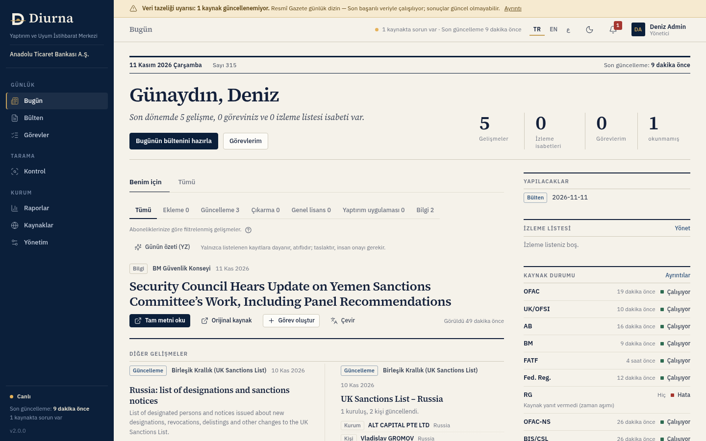
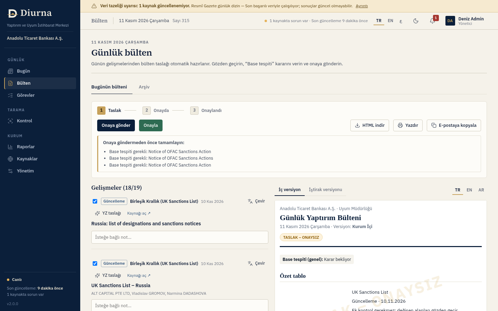
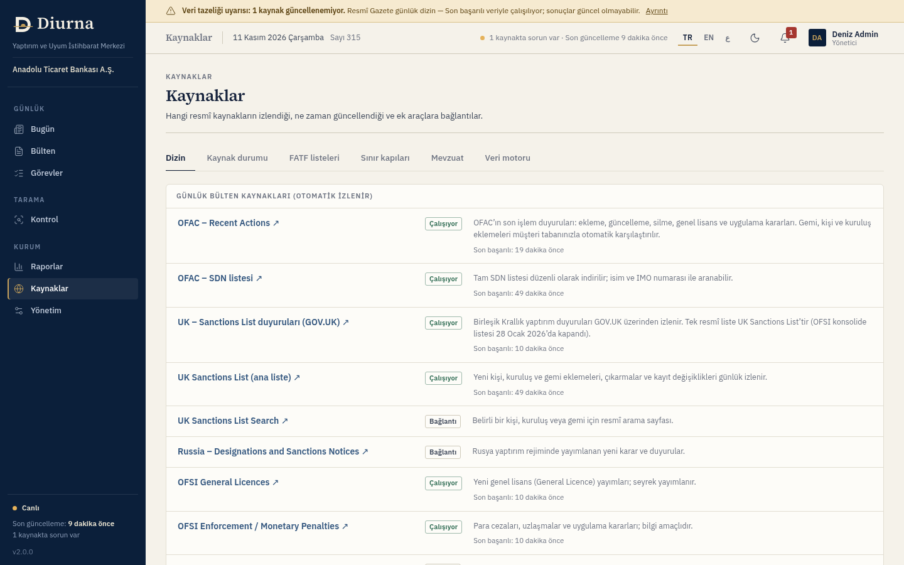
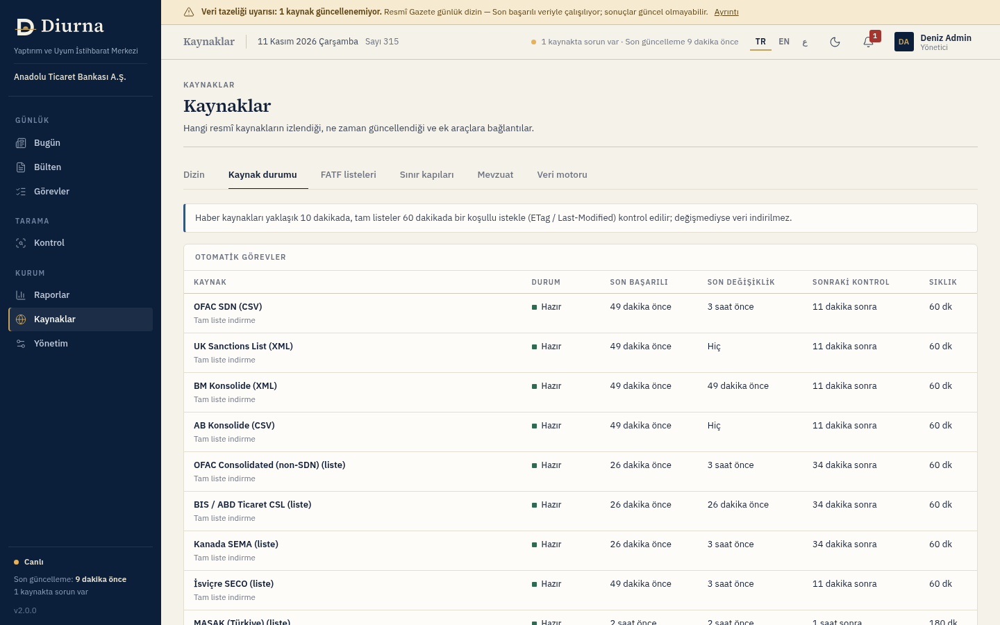

# Diurna

**Sanctions and compliance monitoring platform.** A daily sanctions bulletin, customer-base screening and regulator tracking for banks and their branches, on one screen.

> What changed today. What to do now.

- Live demo: **https://m-yusufuysal.github.io/diurna.ai/**
- Türkçe (ana belge): [README.md](README.md)



## Contents

1. [What Diurna is](#1-what-diurna-is)
2. [Who it is for](#2-who-it-is-for)
3. [Features](#3-features)
4. [Roles and permissions](#4-roles-and-permissions)
5. [First login and account creation](#5-first-login-and-account-creation)
6. [User guide](#6-user-guide)
7. [Data sources and their status](#7-data-sources-and-their-status)
8. [Matching quality](#8-matching-quality)
9. [Administrator guide](#9-administrator-guide)
10. [Security](#10-security)
11. [FAQ](#11-faq)
12. [Known limitations](#12-known-limitations)
13. [Installation / technical](#13-installation--technical)

---

## 1. What Diurna is

Diurna automates the morning routine of a compliance team. It follows the publications of OFAC, the UK, the EU, the UN, MASAK (Türkiye) and Gulf regulators, turns the day's changes into a **daily bulletin**, checks whether those changes affect your **customer base**, and assigns the follow-up to the right person as a **task**.

The name comes from the Latin *diurna* ("daily"), as in Rome's official daily notices, the *Acta Diurna*.

**Value**

- The morning routine drops to minutes: one "Today" screen instead of visiting every source.
- Nothing is missed: sources are watched continuously, automatically and politely.
- People stay in charge: matches are shown with reasons; bulletins and task closures need approval (four-eyes principle).
- Audit-ready: every action goes to an immutable, hash-chained audit trail.
- News and notices can be read inside Diurna without opening the source site.

## 2. Who it is for

Banks, participation banks, financial institutions and their branches and affiliates in Türkiye and the Gulf. Typical users: compliance and sanctions-monitoring teams, branch compliance officers, internal audit and senior management (summaries and reports).

It is multi-tenant: each institution's data is kept separate. Within an institution a **head office → region → branch** hierarchy is supported.

## 3. Features

**Daily work**
- **Today**: personal home screen with highlighted developments, to-dos, watch-list hits and source status. "For me" is filtered by your subscriptions; "All" shows everything.
- **Daily bulletin**: automatic draft in Turkish, English or Arabic, with an **internal** and an **affiliate** version, an approval flow and an immutable archive.
- **Four-eyes approval**: the preparer and the approver must be different people. An empty bulletin cannot be submitted. Approved bulletins are locked and archived with a SHA-256 digest.
- **In-app reader**: read news and notices (including PDFs) inside Diurna, with **Translate** and **AI summary** in the same panel. If a source does not provide full text, the part that could be reached and the reason are shown.
- **Tasks**: create a task from a development or a match; due times (SLA), comments, closure reason and outcome (true match / false positive).
- **Watch list**: add a name, vessel (IMO), country or customs code; matching developments appear on Today and in notifications.
- **Notifications and daily report**: per-event in-app and e-mail rules; a personal daily summary e-mail.

**Screening and checks**
- **Customer-base screening ("base check")**: upload your customer list as CSV; every sanctions list is compared and the reasons for each possible match are shown. When a new listing appears, your base is re-screened automatically.
- **Batch and single search**: look up a name or a list of names without saving them; download results as CSV.
- **Trade check**: customs/HS code, IMO, country and FATF status; EU prohibited-goods annexes and a border-crossing reference.
- **Correspondent bank (DD)**: draft answers to due-diligence questions from a library.
- **Ownership (50% rule)**: adds up share percentages; 50% or more is a block, 25–50% an enhanced-review warning.
- **Adverse news and Interpol**: optional, name-based lookups from the Check screen (an administrator turns them on or off).

**Sources and regulators**
- **Sanctions lists**: OFAC (SDN and non-SDN), UN, EU, UK, Canada, Switzerland, Australia, Japan, US CSL, with change history.
- **MASAK**: asset-freezing lists under Laws 6415 (art. 5/6/7) and 7262 (art. 3A/3B); MASAK announcements, guidance, legislation and administrative-fine pages.
- **Regulator watch**: BDDK, TCMB, SPK, KVKK; in the Gulf EOCN, CBUAE, DFSA, FSRA, SAMA, NCTC, QCB, QFCRA, CBB, CBK, CBO. Alerts on new announcements or page changes.
- **Official Gazette** (Türkiye) and **FATF** grey/black lists.

**Other**
- **AI (optional)**: translation, daily summary, bulletin item draft, match explanation, regulation summary, DD answer draft. Each institution switches it on or off; every use is logged.
- **Languages**: Turkish, English and Arabic (including right-to-left layout).
- **Mobile**: fully usable on phones and tablets.
- **Reports**: analytics, savings (ROI), branch comparison and audit trail.
- **Integration**: API keys and signed webhooks.



## 4. Roles and permissions

Permissions are enforced on the server, not only in the interface.

| Role | What it can do |
|---|---|
| **Admin** | Everything: users and branches, institution settings, list scope, external lookups, security and AI settings, bulletin approval. |
| **Compliance Manager** (*Uyum Yöneticisi*) | Approves or rejects bulletins, manages tasks and matches, runs screening. No access to administration settings. |
| **Analyst** (*Analist*) | Prepares bulletins, creates and closes tasks, runs screening. Cannot approve bulletins. |
| **Reader (affiliate)** (*Okuyucu*) | Sees only the approved **affiliate version** of the bulletin; the internal bulletin, customer identities and the "base check" line are never sent to this user. |
| **Platform** | The team operating Diurna: creates institutions and the first administrator, sets the user limit. Cannot see institution data. |

## 5. First login and account creation

There is no public sign-up and **no billing or payment screen**. Accounts are created by the Diurna team and your institution's administrator.

1. The platform team creates the institution and the first administrator, who is shown a username and a **temporary password** once.
2. The administrator adds colleagues under **Administration → Users** (name, e-mail, role, branch). Each new user gets a temporary password, shown once. The number of users is bound by the limit the platform team sets.
3. On first login with a temporary password two steps are **mandatory**: change the password, then set up **multi-factor authentication (MFA)** with an authenticator app. Nothing else is accessible until both are done.
4. Later logins ask for the password and a code. If you lose your device, use a recovery code or ask your administrator to reset your MFA; if you forget your password, the Diurna team (platform) resets it. First-login steps then apply again.

Password rules: at least 12 characters with upper and lower case, a digit and a symbol. An account is locked for 15 minutes after 5 failed attempts.

## 6. User guide

**Today.** Summary counters, then "For me / All", filter by type (Addition, Update, Removal, General licence, Enforcement, Information). Each item offers *Read full text*, *Original source*, *Create task* and *Translate*. The right column shows to-dos, watch-list hits and **Source status** with each source's last successful read and, if there is a problem, the reason. Data refreshes by itself.

**Bulletin.** A draft is built from the day's developments. Review each item's *Base check* (is there a record in the customer base?), write the intro and closing notes, choose the language, then **Submit for approval**. A different person approves or rejects (a reason is required to reject). Export as HTML, print, or copy for e-mail. The affiliate version contains no customer identities or internal decisions. Approved bulletins go to the **Archive**, immutable and stored with a SHA-256 digest.

**Tasks.** *My tasks / All tasks / Notifications*. A task comes from a development or a customer match, is assigned and tracked against its SLA. When closing, choose the outcome and optionally a reason; this feeds the hit-rate reports.

**Check.** *Customer base*: download the CSV template, drop the file, map the columns, review the row-level validation report, import (up to 10 MB / 20,000 rows; UTF-8 and Windows-1254). *Batch / single search*: type a name or IMO, or drop a CSV; nothing is saved to the customer base. *Trade check*, *Correspondent bank* and *Ownership (50%)* work as described above.

**Reports.** Analytics, savings (ROI), branches, audit trail (integrity is verified; export as CSV/JSON).

**Sources.** *Directory* (live status badge and plain description per source), *Source status* (per-job last run, last success, errors), FATF lists, border crossings, legislation (per-country regulatory layer: BDDK, MASAK, KVKK, Laws 6415/7262; CBUAE, EOCN, SAMA, QCB/NCTC, CBB, Kuwait, Oman), and the data engine.

**My settings.** Profile (language, light/dark theme, download my data), notifications, watch list, daily report (on/off, time, language; sent on weekdays) and security (password, MFA, recovery codes).

**Phones and tablets.** The menu opens as a panel from the top-left icon, tables turn into cards and buttons are sized for fingers.



## 7. Data sources and their status

On **Sources → Directory** every source carries a badge computed from the real configuration and job state, not a hand-written label.

| Badge | Meaning |
|---|---|
| **Working** | The source is read regularly; the last successful read is shown. |
| **Partial** | Part of the source cannot be read (for example some monitored pages); the rest is current. Failed pages and reasons are listed under the row. |
| **Access blocked** | The source cannot be read at all (timeout, the authority does not allow automated reading, connection error…). The reason is shown. |
| **On request** | Runs only when a user triggers it (adverse news, Interpol). |
| **Off – admin can enable** | An administrator can switch it on under Administration → Lists. |
| **Off – licence required** | Needs a licensed data partner; the operating team enables it once a licence is in place. |
| **Link / Built in / Your licence** | Not monitored automatically: a link to the official page, reference data kept inside the app, or your institution's own subscription. |



Sources are fetched once for all institutions, with conditional requests and rate limits. Diurna identifies itself honestly, obeys `robots.txt`, and does not try to bypass bot protection. If a source fails, the last good data is kept and the badge shows the problem.

## 8. Matching quality

Matching is rule-based and **explainable**: each possible match shows reason codes (name similarity, reversed order, ID number, birth year, IMO…). No decision is automated.

- **Turkish**: I/İ/ı/i, ç, ş, ğ, ü, ö do not break matching ("Hüseyin" and "Hussein" are caught as the same).
- **Arabic, Cyrillic and other scripts**: Arabic names are also found in Latin spelling; Cyrillic, Persian and accented spellings are covered.
- **Typos and order**: "Volta Shiping" matches "Volta Shipping"; reordered names match.
- **Company suffixes** such as A.Ş., Ltd. Şti., FZE are ignored.
- **Secondary checks**: an exact ID/passport/tax number is a certain match; a conflicting birth year lowers the score; IMO numbers are validated. A **good-guy list** silences known false positives.
- **Threshold**: the institution threshold (default 85) is set in Administration; per-list thresholds are possible.

Measurement (`scripts/match-eval.js` on labelled pairs): on hand-built multilingual pairs 36 of 40 positives are caught with no false alarms in the test. On real list names, Arabic↔Latin recall is lower (about 46%) and is being improved. See [Known limitations](#12-known-limitations).

## 9. Administrator guide

Administration is available to the **Admin** role only.

| Tab | What you do |
|---|---|
| **Organisation** | Institution name, department, bulletin signature, look-back days, match threshold, four-eyes principle, default language. |
| **Users** | Add users (temporary password shown once), assign role and branch, deactivate, reset MFA. Password resets are done by the platform team. |
| **Branches** | Head office–region–branch hierarchy. |
| **Lists** | Lists included in customer screening and per-list thresholds. The **External lookups** card sets *Adverse news (GDELT)* and *Interpol red notices* to Installation default / On / Off; changes are written to the audit trail. Also the internal block list. |
| **Licensed data partners** | Connect your own data-provider subscription (BYOL, see below). |
| **Legislation and data** | Regulatory layers the institution is subject to (TR, AE, SA, QA, BH, KW, OM) and data-residency record. |
| **Integrations** | E-mail (SMTP), API keys (value shown once), webhooks. A single-sign-on settings form exists but is not functional yet. |
| **Security** | MFA requirement, idle timeout, minimum password length, IP allow-list, retention periods, audit export. |
| **AI** | Switch AI on or off for the institution and view the log. |

**Enabling sources.** For a source marked "Off – admin can enable", the link beside it leads to **Administration → Lists**. Sources marked "Off – licence required" (OpenSanctions fallback, UAE/Qatar/Saudi lists, PEP) need a licence and are enabled at installation level, not from the admin screen.

**AI key.** AI and translation connect to a provider configured at installation (environment variables, see the Turkish document's technical section). The AI tab only switches the feature on or off for your institution; without a configured provider the buttons explain why they do not work, and nothing is fabricated.

### Bring your own licence (BYOL)
If your institution subscribes to a data provider, enter its credentials under **Administration → Licensed data partners** to add that data to customer screening. Diurna neither sells nor redistributes the data; it connects to your provider with your account.

| Provider | Connection type |
|---|---|
| **OpenSanctions** | Verified: the API key is really tested against `api.opensanctions.org` (`Authorization: ApiKey`). Licensed bulk data (UAE, Qatar, Saudi Arabia) is added to screening when it can be fetched; delivery depends on your contract and, if it fails, the reason is shown. |
| Dow Jones Risk & Compliance, LSEG World-Check One, LexisNexis Bridger / WorldCompliance, Moody’s / Bureau van Dijk Orbis, Refinitiv, ComplyAdvantage, Sayari | Generic HTTP adapter (OAuth2, Bearer, Basic or custom header). These providers’ real endpoints depend on your contract, so you enter the addresses and field mapping from your provider’s API documentation. |
| **Custom REST (HTTPS)** | Any HTTPS service: base URL, authentication, JSON or CSV format and field mapping (name, aliases, id, type, country, program, date). SFTP is not supported yet. |

Steps: enter the details on the provider card → **Save** → **Test connection** → **Sync now** → **Include in screening**. Status is always truthful: *Not set up*, *Configured – not tested*, *Connected* or *Error: …*. Synced records appear in your screening as the source “Licensed data partner (your institution)” and carry their own badge in the **Sources** directory.

Security: credentials are encrypted per institution with AES-256-GCM, never returned to the UI or API responses (only the last 4 characters), managed by the Admin role only, every change is written to the audit trail (never the value) and outbound addresses pass the SSRF guard; only public `https://` addresses are accepted. Synced data stays within your institution.

## 10. Security

Details in [SECURITY.md](SECURITY.md).

- **Identity**: Argon2id password hashing, TOTP MFA with one-time recovery codes, lockout, HttpOnly / SameSite=Strict / Secure session cookies.
- **Authorisation**: role checks on every endpoint, per-request tenant isolation.
- **Encryption**: customer files and the SMTP password are encrypted at rest with AES-256-GCM.
- **Audit trail**: hash-chained, append-only; integrity can be verified in the app.
- **Outbound access**: SSRF guard (private and internal addresses blocked, redirects re-validated), polite fetching (per-host rate limit, conditional requests, robots.txt).
- **Privacy**: no customer names or IDs in logs; external lookups send only the searched name, never customer lists; AI output is stored with its sources.
- **Web security**: strict CSP, CSRF token and Origin checks, rate limits, CSV formula-injection protection.
- **Continuous checks (CI)**: secret scanning (gitleaks), dependency audit, static analysis (semgrep), cross-tenant / role / SSRF / header security tests, container scan.

This describes implemented controls; it does not replace an independent penetration test or certification.

## 11. FAQ

**Why are some sources "Access blocked"?** The authority's site does not respond, does not allow automated reading, or returns an error. The reason is under the badge. Diurna does not try to bypass the block; the last good data is kept.

**What does "Off – licence required" mean?** The data needs a licence for commercial use (for example OpenSanctions). It stays off until a licence exists and cannot be enabled from the admin screen.

**Can I enable a source myself?** If the badge says "Off – admin can enable", your administrator can do it under Administration → Lists.

**What if AI is off?** Translate and summary buttons do not work and say why. Monitoring, bulletins and matching work without AI.

**A match was wrong. What now?** Close the task as "false positive"; for recurring cases an administrator can add the party to the good-guy list.

**What does an affiliate Reader see?** Only the approved affiliate version of the bulletin.

**Demo versus the real product?** The demo is a browser-only snapshot: no real login, e-mail, AI or automatic updates, and changes reset on refresh. The real product runs on a server and refreshes sources by itself.

## 12. Known limitations

Observed on 11 November 2026; current status is always shown live on the Sources screen.

- **Official Gazette (Türkiye)**: the site's server does not answer Diurna's honest identity (timeout), so the daily contents cannot currently be read. The fix is an official feed or an agreement with the authority.
- **EOCN (UAE)**: the authority disallows automated reading through `robots.txt`; follow the page manually.
- **Gulf central-bank sites**: connections to CBUAE, Qatar NCTC/QCB and Oman CBO fail; DFSA (HTTP 403) and QFCRA (HTTP 404/403) return errors; the DFAT page times out. These bodies do not publish machine-readable lists either.
- **UAE, Qatar, Saudi lists and PEP**: structured data is only available through a licensed data partner (for example OpenSanctions); a commercial licence is mandatory. Off until licensed.
- **Bahrain**: no machine-readable public sanctions list; only the official page is monitored and no name matching is done.
- **Matching**: Arabic↔Latin recall on real list names is limited; manual checks are advised for high-risk cases.
- **SSO (SAML/OIDC)**: settings form only; not functional.
- **Not available**: an internal PEP database, chained ownership graph, payment-message (SWIFT/ISO 20022) parsing, continuous-monitoring API.
- **Storage**: single node, file-based; multi-node high availability needs a database layer. No independent penetration test has been done.
- **FATF table** is verified by hand after each plenary; the verification date is shown in the app.
- **Legislation summaries** are not legal advice; verify against the current text.

## 13. Installation / technical

Requires Node.js 20 or later (dependencies: `argon2`, `nodemailer`, `any-ascii`, `pdfkit`; `pdftotext` from poppler-utils is recommended for PDF text).

```bash
git clone https://github.com/m-yusufuysal/diurna.ai.git && cd diurna.ai
npm install --omit=dev
export UM_DEMO_PASSWORD="$YOUR_PASSWORD"; node server.js   # http://127.0.0.1:3000
```

On first start a trial institution is created and sources begin fetching on their own (about a minute from cold). Do not use the trial institution in production. For Docker, environment variables (`UM_DATA_KEY` is mandatory in production, `UM_CONTACT`, SMTP, AI and translation providers, optional-source switches) and reverse-proxy/TLS setup, see the table in [README.md](README.md#13-kurulum--teknik) and [DEPLOY.md](DEPLOY.md). Never set `UM_ALLOW_PRIVATE_FETCH=1` in production: it disables the SSRF guard and exists only for sandbox networks whose DNS resolves every host to a private address.

Tests: `npm test`; `UM_TEST_BASE=http://127.0.0.1:3199 node scripts/security-tests.js` against a throw-away instance with empty data directories; `node scripts/match-eval.js`.
