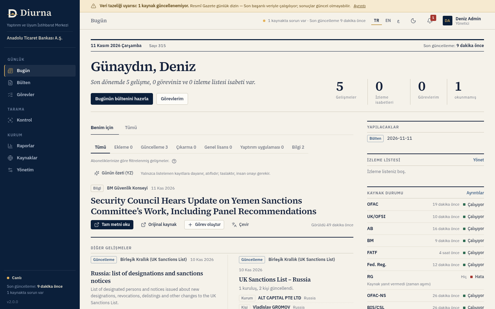
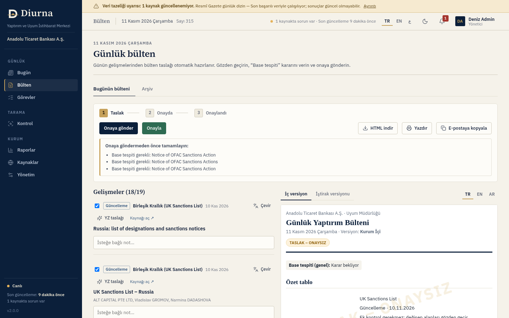
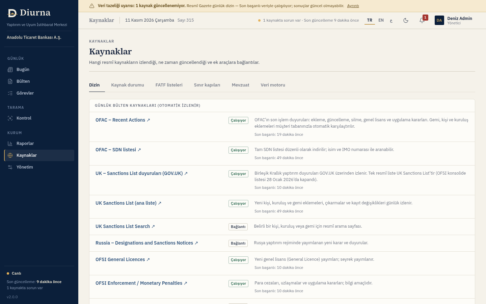
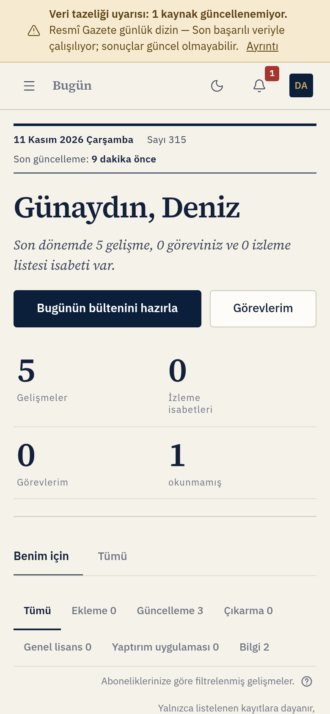
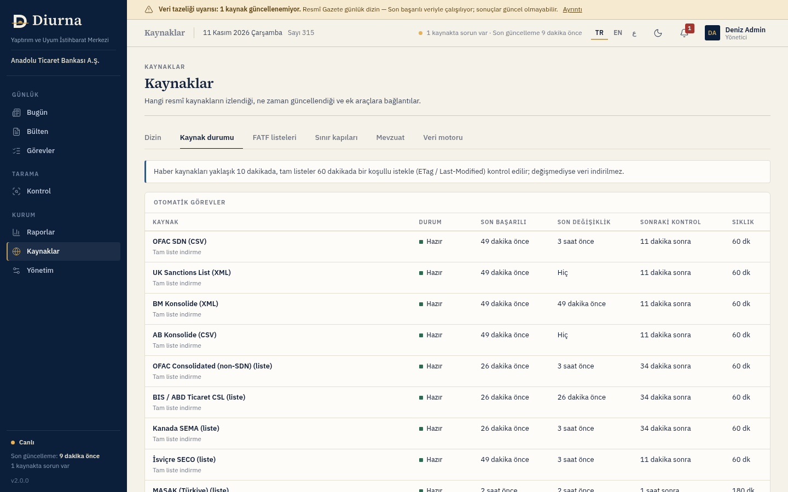

# Diurna

**Yaptırım ve uyum izleme platformu.** Bankalar ve şubeler için günlük yaptırım bülteni, müşteri tabanı eşleştirmesi ve düzenleyici duyuru takibi tek bir ekranda.

> Bugün ne değişti. Şimdi ne yapmalı.

- Canlı demo: **https://m-yusufuysal.github.io/diurna.ai/**
- English version: [README.en.md](README.en.md)



## İçindekiler

1. [Diurna nedir](#1-diurna-nedir)
2. [Kimler için](#2-kimler-için)
3. [Öne çıkan özellikler](#3-öne-çıkan-özellikler)
4. [Roller ve yetkiler](#4-roller-ve-yetkiler)
5. [İlk giriş ve hesap açma](#5-ilk-giriş-ve-hesap-açma)
6. [Kullanım rehberi (ekran ekran)](#6-kullanım-rehberi-ekran-ekran)
7. [Veri kaynakları ve durumları](#7-veri-kaynakları-ve-durumları)
8. [Eşleştirme kalitesi](#8-eşleştirme-kalitesi)
9. [Yönetici rehberi](#9-yönetici-rehberi)
10. [Güvenlik](#10-güvenlik)
11. [Sık sorulan sorular](#11-sık-sorulan-sorular)
12. [Bilinen sınırlamalar](#12-bilinen-sınırlamalar)
13. [Kurulum / Teknik](#13-kurulum--teknik)
14. [English summary](#14-english-summary)

---

## 1. Diurna nedir

Diurna, uyum ekiplerinin her sabah yaptığı işi otomatikleştirir: OFAC, Birleşik Krallık, Avrupa Birliği, Birleşmiş Milletler, MASAK ve Körfez düzenleyicilerinin yayınlarını izler, günün değişikliklerini bir **günlük bültene** dönüştürür, bu değişikliklerin **müşteri tabanınızı** etkileyip etkilemediğini kontrol eder ve çıkan işi sorumlusuna **görev** olarak atar.

Ürünün adı Latince *diurna* (“günlük”) sözcüğünden gelir; Roma’nın resmî günlük duyuruları *Acta Diurna* ile aynı kökten.

**Sağladığı değer**

- Sabah rutini dakikalara iner: kaynakları tek tek gezmek yerine tek bir “Bugün” ekranı.
- Hiçbir değişiklik gözden kaçmaz: kaynaklar kendiliğinden, nazik bir hızla ve sürekli izlenir.
- Karar insanda kalır: eşleşmeler nedenleriyle gösterilir, bülten ve görev kapanışları onaya bağlıdır (dört göz ilkesi).
- Denetime hazır kayıt: her işlem değiştirilemez, zincirli bir denetim izine yazılır.
- Haberi ya da duyuruyu kaynağa gitmeden Diurna içinde okuyabilirsiniz.

## 2. Kimler için

Türkiye ve Körfez bölgesindeki bankalar, katılım bankaları, finansal kuruluşlar ve bunların şubeleri/iştirakleri. Hedef kullanıcılar: uyum müdürlüğü ve yaptırım izleme ekipleri, şube uyum sorumluları, iç denetim ve üst yönetim (özet ve raporlar).

Çok kiracılıdır: her kurumun verisi ayrı tutulur. Kurum içinde **Genel Müdürlük → bölge → şube** hiyerarşisi desteklenir.

## 3. Öne çıkan özellikler

### Günlük çalışma
| Özellik | Açıklama |
|---|---|
| **Bugün** | Kişisel ana ekran: öne çıkan gelişmeler, yapılacaklar, izleme listesi isabetleri, kaynak durumu. “Benim için” sekmesi aboneliklerinize göre süzülür, “Tümü” hepsini gösterir. |
| **Günlük bülten** | Günün gelişmelerinden otomatik taslak. TR/EN/AR dillerinde, **iç** ve **iştirak** versiyonlarıyla. Onay akışı ve değiştirilemez arşiv içerir. |
| **Onay akışı (dört göz)** | Bülteni hazırlayan ile onaylayan farklı kişi olur. Boş bülten onaya gönderilemez. Onaylanan bülten kilitlenir, SHA-256 özetiyle arşivlenir. |
| **Uygulama içi okuyucu** | Haber ve duyuru metni (PDF dahil) Diurna içinde okunur; **Çevir** ve **YZ özeti** aynı panelde. Kaynak metni vermezse ulaşılabilen kısım ve nedeni gösterilir. |
| **Görevler** | Bir gelişmeden ya da eşleşmeden görev oluşturun; süre (SLA), yorum, kapanış gerekçesi ve sonucu (gerçek eşleşme / yanlış pozitif) kaydedilir. |
| **İzleme listesi** | İsim, gemi (IMO), ülke veya GTİP kodu ekleyin; ilgili gelişme çıktığında Bugün ekranında ve bildirimlerde görünür. |
| **Bildirimler ve günlük rapor** | Olay bazında uygulama içi ve e-posta kuralları; kişisel günlük özet e-postası. |

### Tarama ve kontrol
| Özellik | Açıklama |
|---|---|
| **Müşteri tabanı eşleştirme (base tespiti)** | Müşteri listenizi CSV ile yükleyin; sistem tüm yaptırım listeleriyle karşılaştırır, her olası eşleşmenin nedenini gösterir. Yeni bir listeleme çıktığında müşteri tabanınız otomatik yeniden taranır. |
| **CSV toplu ve tekil arama** | Müşteri tabanına kaydetmeden isim listesi ya da tek isim arayın; sonuçlar CSV olarak indirilir. |
| **Ticaret kontrolü** | GTİP/HS kodu, IMO, ülke ve FATF durumu; AB yasaklı ürün ekleri ve sınır kapıları referansı. |
| **Muhabir banka (DD)** | Durum tespiti sorularına kütüphaneden cevap taslağı. |
| **Sahiplik (%50 kuralı)** | Girilen pay oranlarını toplar: %50 ve üzeri engel, %25–%50 arası artırılmış inceleme uyarısı. |
| **Olumsuz haber ve Interpol** | Kontrol ekranında isim bazlı isteğe bağlı sorgular (yönetici açıp kapatır). |

### Kaynak ve düzenleyici takibi
| Özellik | Açıklama |
|---|---|
| **Yaptırım listeleri** | OFAC (SDN ve SDN dışı), BM, AB, Birleşik Krallık, Kanada, İsviçre, Avustralya, Japonya, ABD CSL; değişiklik geçmişiyle. |
| **MASAK** | 6415 (md. 5/6/7) ve 7262 (md. 3A/3B) sayılı kanunlara göre mal varlığı dondurma listeleri; MASAK duyuruları, rehberler, mevzuat ve idari para cezası sayfaları. |
| **Düzenleyici izleme** | BDDK, TCMB, SPK, KVKK; Körfezde EOCN, CBUAE, DFSA, FSRA, SAMA, NCTC, QCB, QFCRA, CBB, CBK, CBO. Yeni duyuru ya da sayfa değişikliğinde uyarı. |
| **Resmî Gazete** | Günlük içindekiler taranır; yaptırım ve mal varlığı dondurma ile ilgili ilanlar öne çıkarılır. |
| **FATF** | Kara ve gri liste tablosu. |

### Diğer
| Özellik | Açıklama |
|---|---|
| **Yapay zekâ (isteğe bağlı)** | Çeviri, günlük özet, bülten maddesi taslağı, eşleşme açıklaması, mevzuat özeti, DD cevap taslağı. Her kurum açıp kapatır; her kullanım kayda geçer. |
| **Diller** | Türkçe, İngilizce ve Arapça (sağdan sola düzen dahil). Bülten dili de seçilebilir. |
| **Mobil uyum** | Telefon ve tablette tam çalışır: açılır menü, kart görünümlü tablolar, parmakla rahat basılan düğmeler. |
| **Raporlar** | Analitik, tasarruf (ROI), şube karşılaştırması ve denetim izi. |
| **Entegrasyon** | API anahtarı ve imzalı webhook (olaylar: yeni gelişme, eşleşme, bülten onayı, görev kapanışı). |



## 4. Roller ve yetkiler

Yetkiler sunucuda denetlenir; arayüzde bir düğmenin gizlenmesine güvenilmez.

| Rol | Ne yapabilir |
|---|---|
| **Admin** | Her şey: kullanıcı ve şube yönetimi, kurum ayarları, liste kapsamı, dış sorgular, güvenlik ve YZ ayarları, bülten onayı. |
| **Uyum Yöneticisi** | Bülteni onaylar/reddeder, görev ve eşleşmeleri yönetir, tarama yapar. Yönetim ayarlarına erişmez. |
| **Analist** | Bülten hazırlar, görev oluşturur ve kapatır, tarama yapar. Bülteni onaylayamaz. |
| **Okuyucu (iştirak)** | Yalnızca onaylanmış **iştirak versiyonu** bülteni görür; iç bülten, müşteri kimlikleri ve “Base tespiti” satırı kendisine hiç gönderilmez. |
| **Platform** | Diurna’yı işleten ekibin hesabı: kurum açar, ilk yöneticiyi oluşturur, kullanıcı sınırını belirler. Kurum verilerine erişemez. |

## 5. İlk giriş ve hesap açma

Herkese açık kayıt yoktur ve **faturalama/ödeme ekranı bulunmaz**. Hesapları Diurna ekibi ve kurum yöneticisi açar.

1. Platform ekibi kurumu ve ilk yöneticiyi oluşturur. Yöneticiye kullanıcı adı ve **geçici parola** bir kez gösterilir.
2. Kurum yöneticisi, **Yönetim → Kullanıcılar** ekranından çalışanlarını ekler (ad, e-posta, rol, şube). Her yeni kullanıcıya geçici parola üretilir ve bir kez gösterilir. Kullanıcı sayısı, platform ekibinin kurum için tanımladığı sınıra bağlıdır.
3. Geçici parolayla ilk girişte **zorunlu** iki adım vardır: önce parolayı değiştirme, sonra **iki aşamalı doğrulama (MFA)** kurulumu (kimlik doğrulayıcı uygulama ile). Bu iki adım bitmeden sistem başka hiçbir ekrana izin vermez.
4. Sonraki girişlerde parola ve doğrulama kodu istenir. Doğrulama cihazınızı kaybederseniz kurtarma kodlarını kullanın ya da yöneticinizden MFA’nızı sıfırlamasını isteyin; parolanızı unuttuysanız Diurna ekibi (platform) sıfırlar. Her iki durumda ilk giriş adımları yeniden uygulanır.

Parola kuralları: en az 12 karakter, büyük/küçük harf, rakam ve sembol. Hesap, 5 hatalı denemeden sonra 15 dakika kilitlenir.

## 6. Kullanım rehberi (ekran ekran)

### Bugün
Oturum açınca ilk gördüğünüz ekran.
- **Üst özet:** son dönemdeki gelişme sayısı, açık görevleriniz, izleme isabetleri, okunmamış bildirimler.
- **Benim için / Tümü:** “Benim için” yalnızca abone olduğunuz kaynakları gösterir. Türe göre süzün: Ekleme, Güncelleme, Çıkarma, Genel lisans, Yaptırım uygulaması, Bilgi.
- **Her gelişmede:** *Tam metni oku* (uygulama içi okuyucu), *Orijinal kaynak*, *Görev oluştur*, *Çevir*. Müşteri tabanınızda olası eşleşme varsa kartta görünür.
- **Sağ sütun:** yapılacaklar, izleme listesi isabetleri ve **Kaynak durumu** (her kaynağın son başarılı okuması; sorun varsa nedeni).
- Veriler kendiliğinden güncellenir; yenilemeniz gerekmez.

### Bülten
1. **Bugünün bülteni:** gelişmelerden taslak otomatik oluşur. Her madde için *Base tespiti* (müşteri tabanında kayıt var/yok) ve eşleşme notunu gözden geçirin; giriş ve kapanış notunu yazın. Bülten dilini TR/EN/AR seçebilirsiniz.
2. **Onaya gönder:** eksikler varsa sistem neyin tamamlanması gerektiğini söyler.
3. **Onayla / Reddet:** onay, hazırlayandan farklı bir kişiden gelmelidir. Reddetmek için gerekçe yazılır; bülten yeniden açılabilir.
4. **Çıktı:** HTML indirme, yazdırma ya da e-postaya kopyalama. İştirak versiyonu müşteri kimliği ve iç kararları içermez.
5. **Arşiv:** onaylanan bültenler değiştirilemez ve SHA-256 özetiyle saklanır.

### Görevler
- **Görevlerim / Tüm görevler / Bildirimler** sekmeleri.
- Görev; bir gelişmeden ya da müşteri eşleşmesinden oluşturulur, atanır, süresi (SLA) izlenir. Süresi aşılan görevler işaretlenir.
- Kapatırken sonucu seçin (gerçek eşleşme, yanlış pozitif…) ve isteğe bağlı gerekçe yazın; bu bilgi raporlardaki isabet oranını besler.

### Kontrol
- **Müşteri tabanı:** CSV şablonunu indirin, dosyayı sürükleyip bırakın, sütunları eşleyin, satır bazlı doğrulama raporunu inceleyin ve içe aktarın (en çok 10 MB / 20.000 satır; UTF-8 ve Windows-1254 kodlamaları desteklenir). Sonuçta olası eşleşmeler nedenleriyle listelenir; her biri için görev açabilirsiniz.
- **Toplu / tekil arama:** isim ya da IMO yazıp *Ara*’ya basın; ya da CSV bırakın. Müşteri tabanına kaydedilmez. *Olumsuz haber* düğmesi (yönetici açtıysa) isim için dış basında arama yapar.
- **Ticaret kontrolü:** GTİP/HS kodu, IMO, ülke ve FATF durumu girin; yasaklı ürün eki, ülke riski ve gemi bilgisi birlikte değerlendirilir.
- **Muhabir banka:** DD sorusunu yazın; kütüphaneden cevap taslağı gelir. Taslağı mutlaka inceleyin.
- **Sahiplik (%50):** ortakları ve pay oranlarını girin; eşik aşımı uyarısı alın.

### Raporlar
- **Analitik:** gelişme, eşleşme ve görev eğilimleri.
- **Tasarruf (ROI):** manuel süreçle karşılaştırmalı tahmini kazanç; varsayımları yönetici ayarlar.
- **Şubeler:** şube bazlı görev ve eşleşme görünümü.
- **Denetim izi:** kim, ne zaman, ne yaptı. Zincir bütünlüğü doğrulanır; CSV/JSON olarak indirilir.

### Kaynaklar
- **Dizin:** her kaynak için canlı durum rozeti ve sade açıklama (bkz. [Veri kaynakları](#7-veri-kaynakları-ve-durumları)).
- **Kaynak durumu:** iş bazında son çalışma, son başarı ve varsa hata.
- **FATF listeleri, Sınır kapıları, Mevzuat:** referans tabloları ve ülke bazlı düzenleyici katman (BDDK, MASAK, KVKK, 6415/7262; CBUAE, EOCN, SAMA, QCB/NCTC, CBB, Kuveyt, Umman).
- **Veri motoru:** listelerdeki toplam kayıt, değişiklik geçmişi ve nazik çekim politikası.



### Ayarlarım
- **Profil:** dil (TR/EN/AR), açık/koyu tema, verilerimi indir.
- **Bildirimler:** hangi olayda uygulama içi, hangisinde e-posta gelsin; abone olduğunuz kaynaklar.
- **İzleme listesi:** isim, IMO, ülke ya da GTİP ekleyin.
- **Günlük rapor:** kişisel özet e-postasını açma/kapama, saat ve dil (hafta içi günlerde gönderilir).
- **Güvenlik:** parola değiştirme, MFA ve kurtarma kodları.

### Telefon ve tablet
Menü, sol üstteki simgeden açılan bir panele dönüşür. Tablolar kart görünümüne geçer; düğmeler parmakla kolay basılacak boyuttadır. Okuyucu, giriş ve MFA ekranları da telefona uyumludur.



## 7. Veri kaynakları ve durumları

**Kaynaklar → Dizin** ekranında her kaynağın yanında, gerçek yapılandırma ve iş durumundan hesaplanan bir rozet görünür. Rozetler elle yazılmış etiket değildir; sistem her açılışta durumu yeniden hesaplar.

| Rozet | Anlamı |
|---|---|
| **Çalışıyor** | Kaynak düzenli okunuyor; son başarılı okuma zamanı gösterilir. |
| **Kısmi** | Kaynağın bir kısmı okunamıyor (örneğin izlenen sayfalardan bazıları); kalanı güncel. Okunamayan sayfalar ve nedenleri satır altında yazar. |
| **Erişim engelli** | Kaynak hiç okunamıyor (zaman aşımı, kurum otomatik okumaya izin vermiyor, bağlantı hatası…). Neden gösterilir. |
| **Talep üzerine** | Yalnızca siz kullandığınızda çalışır (olumsuz haber, Interpol). |
| **Kapalı – yönetici açabilir** | Yönetici Yönetim → Listeler ekranından açabilir. |
| **Kapalı – lisans gerekli** | Lisanslı bir veri ortağı gerektirir; sistemi işleten ekip lisans alındıktan sonra etkinleştirir. |
| **Bağlantı / Uygulama içinde / Kurumun lisansı** | Kendiliğinden izlenmeyen kaynaklar: resmî sayfaya bağlantı, uygulamanın içinde tutulan referans veri ya da kurumunuzun kendi aboneliği. |



**Kaynak grupları**

- **Günlük bülten kaynakları:** OFAC (Recent Actions ve SDN), Birleşik Krallık (UK Sanctions List, OFSI duyuruları), AB (Resmî Gazete L serisi ve konsolide finansal yaptırım listesi), BM Güvenlik Konseyi (basın ve konsolide liste), FATF.
- **Küresel ve bölgesel listeler:** OFAC SDN dışı, ABD CSL (varsayılan olarak müşteri taramasında kapalı), Kanada SEMA, İsviçre SECO, ABD Federal Register, Resmî Gazete, Avustralya DFAT, Japonya MOF; BAE, Katar ve Suudi Arabistan yerel terör listeleri ile PEP (lisanslı veri ortağı gerektirir).
- **Türkiye:** MASAK mal varlığı dondurma listeleri; MASAK, BDDK, TCMB, SPK ve KVKK duyuruları; Resmî Gazete.
- **Körfez ve diğer düzenleyiciler:** BAE (EOCN, CBUAE, DFSA, FSRA), SAMA, Katar (NCTC, QCB, QFCRA), Bahreyn CBB, Kuveyt CBK, Umman CBO, DFAT/MOF resmî sayfaları. Bu kurumlar makine tarafından okunabilir liste yayımlamadığından sayfa değişikliği izlenir ve değişiklikte uyarı verilir.
- **Ticaret, gemi ve mevzuat:** TARIC, AB 833/2014 ve 2022/428, çift kullanımlı ürünler, gemi sorgu bağlantıları, sınır kapıları.
- **Lisanslı araçlar:** World-Check, Spark Interfax, Bankers Almanac, Seasearcher. Bunlar kurumun kendi aboneliğiyle kullanılır; Diurna bağlantı verir.

**Nasıl çekilir:** Kaynaklar tüm kurumlar için tek ortak istekle, koşullu istek ve hız sınırıyla çekilir. Diurna dürüst bir kimlikle gider, `robots.txt` kurallarına uyar, bot korumasını aşmaya çalışmaz. Bir kaynak başarısız olursa son başarılı veri korunur ve durum rozeti sorunu gösterir.

## 8. Eşleştirme kalitesi

Eşleştirme kural tabanlıdır ve **açıklanabilir**: her olası eşleşmede neden kodları (ad benzerliği, ters sıra, kimlik numarası, doğum yılı, IMO…) gösterilir. Otomatik karar verilmez.

- **Türkçe:** I/İ/ı/i, ç, ş, ğ, ü, ö harfleri eşleşmeyi bozmaz (“Hüseyin” ile “Hussein” aynı kişi olarak yakalanır).
- **Arapça, Kiril ve diğer yazılar:** Arapça yazılmış isimler Latin harfleriyle de bulunur (“Muhammed”, “Mohammed”, “محمد”); Kiril, Farsça ve aksanlı yazımlar kapsanır.
- **Yazım hatası ve sıra:** “Volta Shiping” ile “Volta Shipping” eşleşir; isim sırası değişse de (“Ali Veli” / “Veli Ali”) eşleşme çalışır.
- **Şirket ekleri:** A.Ş., Ltd. Şti., FZE gibi ekler yok sayılır.
- **İkincil doğrulama:** kimlik/pasaport/vergi numarası birebir uyuyorsa kesin eşleşme; doğum yılı çelişiyorsa puan düşer; IMO numarası geçerlilik kontrolünden geçer. **Good-guy listesi** bilinen yanlış pozitifleri susturur.
- **Eşik:** kurum eşiği (varsayılan 85) Yönetim’den ayarlanır; liste bazında farklı eşik tanımlanabilir.

Ölçüm (depodaki `scripts/match-eval.js` ve etiketli örnek çiftler): el yapımı çok dilli çiftlerde 40 pozitiften 36’sı yakalanır; testte yanlış alarm yoktur. Gerçek liste adlarında Arapça↔Latin eşleşme oranı daha düşüktür (yaklaşık %46); bu alan geliştirilmektedir. Bkz. [Bilinen sınırlamalar](#12-bilinen-sınırlamalar).

## 9. Yönetici rehberi

Yönetim menüsü yalnızca **Admin** rolüne açıktır.

| Sekme | Ne yapılır |
|---|---|
| **Kuruluş** | Kurum adı, bölüm, bülten imzası, geriye bakış gün sayısı, eşleşme eşiği, dört göz ilkesi, varsayılan dil. |
| **Kullanıcılar** | Kullanıcı ekleme (geçici parola bir kez gösterilir), rol ve şube atama, pasife alma, MFA sıfırlama. Parola sıfırlama platform ekibindedir. |
| **Şubeler** | Genel Müdürlük–bölge–şube hiyerarşisi. Şube kullanıcıları ve raporları buna göre ayrışır. |
| **Listeler** | Müşteri taramasına dahil edilecek listeler ve liste bazında eşik. **Dış sorgular** kartı: *Olumsuz haber taraması (GDELT)* ve *Interpol kırmızı bülten sorgusu* için Kurulum varsayılanı / Açık / Kapalı seçimi. Değişiklik denetim izine yazılır. Ayrıca kurum içi engelleme listesi. |
| **Lisanslı veri ortakları** | Kendi veri sağlayıcı aboneliğinizi bağlama (BYOL, aşağıya bakın). |
| **Mevzuat ve veri** | Kurumun tabi olduğu ülke katmanları (TR, AE, SA, QA, BH, KW, OM) ve veri yerleşimi kaydı. |
| **Entegrasyonlar** | E-posta (SMTP) ayarı, API anahtarları (değer bir kez gösterilir), webhook’lar. Kurumsal tek oturum (SSO) için ayar alanı vardır; henüz çalışmaz. |
| **Güvenlik** | MFA zorunluluğu, oturum zaman aşımı, en az parola uzunluğu, IP izin listesi, saklama süreleri, denetim izi dışa aktarımı. |
| **Yapay zekâ** | Kurum için YZ’yi açma/kapama ve kayıtlar. Açık olduğunda hangi sağlayıcının kullanıldığı gösterilir. |

**Kaynakları açmak:** *Kaynaklar → Dizin*’de “Kapalı – yönetici açabilir” rozetli bir kaynak için yanındaki bağlantı sizi doğrudan **Yönetim → Listeler** ekranına götürür. “Kapalı – lisans gerekli” rozetli kaynaklar (OpenSanctions yedeği, BAE/Katar/Suudi listeleri, PEP) bir lisans gerektirir ve kurulum düzeyinde etkinleştirilir; yönetici ekranından açılmaz.

**Yapay zekâ anahtarı:** YZ ve çeviri özellikleri, kurulumda tanımlanan bir sağlayıcıya bağlanır (ortam değişkenleri, bkz. [Kurulum / Teknik](#13-kurulum--teknik)). Yönetim → Yapay zekâ ekranı özelliği kurum için açıp kapatır; anahtar tanımlı değilse düğmeler neden çalışmadığını açıklar ve hiçbir çıktı uydurulmaz.

### Kendi lisansınızı bağlama (BYOL)
Kurumunuzun kendi aboneliği olan bir veri sağlayıcısı varsa, kimlik bilgilerini **Yönetim → Lisanslı veri ortakları** ekranına girerek verisini müşteri taramasına katabilirsiniz. Diurna veriyi kendisi satın almaz ya da dağıtmaz; yalnızca sizin hesabınızla sizin sağlayıcınıza bağlanır.

| Sağlayıcı | Bağlantı türü |
|---|---|
| **OpenSanctions** | Doğrulanmış: API anahtarı `api.opensanctions.org` üzerinde (`Authorization: ApiKey`) gerçekten sınanır. Lisanslı toplu veri (BAE, Katar, Suudi Arabistan) alınabilirse taramaya eklenir; teslim biçimi sözleşmenize bağlıdır, alınamazsa nedeni ekranda görünür. |
| Dow Jones Risk & Compliance, LSEG World-Check One, LexisNexis Bridger / WorldCompliance, Moody’s / Bureau van Dijk Orbis, Refinitiv, ComplyAdvantage, Sayari | Genel HTTP bağdaştırıcısı (OAuth2, Bearer, Basic ya da özel başlık). Bu sağlayıcıların gerçek uç noktaları sözleşmeye göre değiştiği için adresleri ve alan eşlemesini sağlayıcınızın API belgesinden siz girersiniz. |
| **Özel REST (HTTPS)** | Herhangi bir HTTPS servisi: temel adres, kimlik doğrulama, JSON ya da CSV biçimi ve alan eşlemesi (ad, takma ad, kimlik, tür, ülke, program, tarih). SFTP henüz desteklenmez. |

Adımlar: sağlayıcı kartında bilgileri girin → **Kaydet** → **Bağlantıyı test et** → **Şimdi eşitle** → **Taramaya dahil et**. Durum her zaman gerçektir: *Kurulmadı*, *Yapılandırıldı – test edilmedi*, *Bağlı* ya da *Hata: …*. Eşitlenen kayıtlar kurumunuzun taramasında “Lisanslı veri ortağı (kurumunuz)” kaynağı olarak görünür ve **Kaynaklar** dizininde kendi rozetini taşır.

Güvenlik: kimlik bilgileri kurumunuza özel olarak AES-256-GCM ile şifrelenir, arayüze ya da API yanıtlarına geri verilmez (yalnızca son 4 karakter), yalnızca Admin rolü yönetir, her değişiklik denetim izine yazılır (değer yazılmaz) ve giden adresler SSRF korumasından geçer; yalnızca genel `https://` adresleri kabul edilir. Eşitlenen veri kurumunuza özeldir, diğer kurumlarla paylaşılmaz.

## 10. Güvenlik

Ayrıntılı eşleme için [SECURITY.md](SECURITY.md).

- **Kimlik:** parolalar Argon2id ile saklanır; MFA (TOTP) ve tek kullanımlık kurtarma kodları; hesap kilitleme; oturum çerezleri HttpOnly, SameSite=Strict ve HTTPS’te Secure.
- **Yetki:** rol denetimi her uç noktada sunucuda yapılır; kiracılar arası veri izolasyonu istek bazında uygulanır.
- **Şifreleme:** müşteri dosyaları ve SMTP parolası AES-256-GCM ile bekleyen veri olarak şifrelenir.
- **Denetim izi:** hash zincirli, yalnızca eklenen kayıt; bütünlük ekrandan doğrulanır.
- **Dış bağlantılar:** SSRF koruması (özel/iç ağ adreslerine çıkış engellenir, yönlendirmeler tek tek doğrulanır); nazik çekim (host başına hız sınırı, koşullu istek, robots uyumu).
- **Gizlilik:** günlüklere müşteri adı/kimlik yazılmaz; dış sorgularda yalnızca aranan isim gider, müşteri listeleri asla gönderilmez; YZ çıktıları kaynaklarıyla birlikte kaydedilir.
- **Web güvenliği:** katı CSP, CSRF belirteci ve Origin denetimi, hız sınırı, CSV formül enjeksiyonu koruması.
- **Sürekli denetim (CI):** sır taraması (gitleaks), bağımlılık denetimi, statik analiz (semgrep), çok kiracılı yetki/SSRF/başlık güvenlik testleri ve konteyner taraması.

Not: Bu liste uygulanmış kontrolleri anlatır; bağımsız sızma testi ya da sertifikasyon yerine geçmez.

## 11. Sık sorulan sorular

**Kaynaklar ekranında neden bazı kaynaklar “Erişim engelli” görünüyor?**
Kurum sitesi yanıt vermiyor, otomatik okumaya izin vermiyor ya da hata dönüyor demektir. Nedeni rozetin altında yazar. Diurna engeli aşmaya çalışmaz; son başarılı veri korunur.

**“Kapalı – lisans gerekli” ne demek?**
Kaynağın verisi ticari kullanımda lisans ister (örneğin OpenSanctions). Lisans alınana kadar kapalı kalır; yönetici ekranından açılmaz.

**Bir kaynağı kendim açabilir miyim?**
Rozet “Kapalı – yönetici açabilir” ise yöneticiniz Yönetim → Listeler ekranından açar. Başka rozetler için yukarıdaki tabloya bakın.

**Yapay zekâ kapalıysa ne olur?**
Çeviri ve özet düğmeleri çalışmaz, ekranda nedeni yazar. Diğer her şey (izleme, bülten, eşleştirme) YZ’siz çalışır.

**Eşleşme yanlış çıktıysa ne yapmalıyım?**
Görevi “yanlış pozitif” olarak kapatın; tekrar eden durumlar için yöneticiniz good-guy listesine ekleyebilir.

**Okuyucu (iştirak) kullanıcısı neleri görür?**
Yalnızca onaylanmış iştirak versiyonu bülteni. İç bülten ve müşteri bilgileri o kullanıcıya hiç gönderilmez.

**Parolamı ya da MFA cihazımı kaybettim.**
Cihazınızı kaybettiyseniz kurtarma kodlarını kullanın; kodunuz yoksa yöneticiniz MFA’nızı sıfırlar. Parolayı Diurna ekibi (platform) sıfırlar. Sıfırlama sonrası ilk giriş adımları yeniden uygulanır.

**Demo ile gerçek sürüm arasındaki fark nedir?**
Demo tarayıcıda çalışan, veriden alınmış anlık görüntüdür: giriş, e-posta, gerçek YZ ve otomatik güncelleme yoktur; yaptığınız değişiklik sayfa yenilenince sıfırlanır. Gerçek sürüm sunucuda çalışır ve kaynakları kendiliğinden günceller.

## 12. Bilinen sınırlamalar

Aşağıdaki durumlar 11 Kasım 2026 tarihli gözlemlerdir; güncel durum Kaynaklar ekranında canlı görünür.

- **Resmî Gazete:** sitenin sunucusu Diurna’nın dürüst kimliğine yanıt vermiyor (zaman aşımı); günlük içindekiler şu an okunamıyor. Çözüm resmî bir besleme ya da kurumla görüşmedir.
- **EOCN (BAE):** kurum, `robots.txt` ile otomatik okumaya izin vermiyor; sayfa elle takip edilmelidir.
- **Körfez merkez bankası siteleri:** CBUAE, Katar NCTC/QCB ve Umman CBO sitelerine bağlantı kurulamıyor; DFSA (HTTP 403) ve QFCRA (HTTP 404/403) hata dönüyor. DFAT sayfası zaman aşımına uğruyor. Bu kurumlar makine tarafından okunabilir liste de yayımlamıyor.
- **BAE, Katar, Suudi Arabistan listeleri ve PEP:** yapılandırılmış veri yalnızca lisanslı bir veri ortağıyla (örneğin OpenSanctions) alınabilir; ticari kullanımda lisans zorunludur. Lisans alınana kadar bu kaynaklar kapalıdır.
- **Bahreyn:** makine tarafından okunabilir kamu yaptırım listesi yoktur; yalnızca resmî sayfa izlenir, isim eşleştirmesi yapılmaz.
- **Eşleştirme:** Arapça↔Latin yazımda gerçek liste adlarında yakalama oranı sınırlıdır; yüksek riskli durumlarda manuel kontrol önerilir.
- **SSO (SAML/OIDC):** yalnızca ayar alanıdır, çalışmaz.
- **Yok:** dahili PEP veritabanı, zincirleme sahiplik grafı, ödeme mesajı (SWIFT/ISO 20022) ayrıştırma, sürekli izleme API’si.
- **Depolama:** tek düğüm, dosya tabanlı; çok düğümlü yüksek erişilebilirlik için veritabanı katmanı gerekir. Bağımsız sızma testi yapılmamıştır.
- **FATF tablosu** her genel kuruldan sonra elle doğrulanıp güncellenir; doğrulama tarihi uygulamada görünür.
- **Mevzuat özetleri** hukuki görüş değildir; güncel metinden doğrulayın.

---

## 13. Kurulum / Teknik

Bu bölüm sistemi işleten teknik ekip içindir.

### Gereksinimler
Node.js 20 veya üzeri. Bağımlılıklar: `argon2`, `nodemailer`, `any-ascii`, `pdfkit`. PDF metin çıkarımı için sunucuda `pdftotext` (poppler-utils) bulunması önerilir.

### Hızlı başlangıç
```bash
git clone https://github.com/m-yusufuysal/diurna.ai.git && cd diurna.ai
npm install --omit=dev
export UM_DEMO_PASSWORD="$YOUR_PASSWORD"; node server.js    # http://127.0.0.1:3000
```
İlk açılışta bir deneme kurumu oluşturulur ve kaynaklar kendiliğinden çekilmeye başlar (soğuk başlangıçta yaklaşık bir dakika). Deneme kullanıcıları: `admin@demo-banka.example` (Admin), `yonetici@demo-banka.example` (Uyum Yöneticisi), `analist1@demo-banka.example` ve `analist2@demo-banka.example` (Analist), `istirak@demo-banka.example` (Okuyucu). Üretimde deneme kurumunu kullanmayın (`NODE_ENV=production` ile birlikte `UM_SEED_DEMO` verilmedikçe tohumlanmaz).

Platform yöneticisi ilk açılışta oluşturulur (kullanıcı adı `platform`); geçici parola `UM_PLATFORM_PASSWORD` ile verilir ya da `data/state/platform-admin.txt` dosyasına yazılır.

### Docker
```bash
cat > .env <<'ENVFILE'
UM_DATA_KEY=<openssl rand -hex 32 çıktısı>
UM_CONTACT=uyum@bankaniz.example
ENVFILE
docker compose up -d --build
```
Uygulama `127.0.0.1:3000` üzerinde dinler; dışarıya TLS sonlandıran bir ters vekil ya da Cloudflare Tunnel açın. Veri `diurna-data` biriminde kalıcıdır. Ayrıntılar: [DEPLOY.md](DEPLOY.md). Uygulama sürekli çalışan bir süreç, zamanlayıcı ve canlı bağlantı kullandığından Vercel/Netlify gibi sunucusuz platformlara uygun değildir.

### Ortam değişkenleri
| Değişken | Anlam |
|---|---|
| `PORT`, `HOST` | Dinleme portu ve adresi (varsayılan 3000 / 127.0.0.1) |
| `UM_DATA_DIR`, `UM_CACHE_DIR` | Kurum verisi ve küresel önbellek dizinleri |
| `UM_DATA_KEY` | 32 baytlık AES-256-GCM anahtarı (hex/base64). **Üretimde zorunlu**; yedekleyin, kaybederseniz şifreli veri açılamaz |
| `UM_FORCE_SECURE=1`, `UM_TRUST_PROXY=1`, `UM_ALLOWED_ORIGINS` | TLS ve ters vekil arkasında çalışma: güvenli çerez, HSTS, vekil başlıklarına güven, ek izinli Origin’ler |
| `UM_CONTACT` | Dış kaynaklara giden kimlikteki iletişim adresi (**kurumunuzunkini yazın**) |
| `UM_PLATFORM_EMAIL`, `UM_PLATFORM_PASSWORD` | Platform yöneticisi hesabı |
| `UM_DEMO_PASSWORD`, `UM_SEED_DEMO` | Deneme kurumu parolası; üretimde tohumlamayı açma |
| `UM_SMTP_HOST/PORT/USER/PASS/FROM` | Gerçek e-posta. Yoksa e-postalar giden kutusuna yazılır, dışarı gönderilmez |
| `UM_TZ` | Gün sınırı saat dilimi (varsayılan Europe/Istanbul) |
| `UM_POLL_NEWS_MIN`, `UM_POLL_LISTS_MIN` | Haber (en az 5, varsayılan 10) ve liste (en az 30, varsayılan 60) yoklama dakikası |
| `UM_HOST_MIN_GAP_MS` | Aynı siteye istekler arası asgari süre |
| `UM_LLM_BASE_URL`, `UM_LLM_API_KEY`, `UM_LLM_MODEL`, `UM_LLM_ONPREM=1` | YZ sağlayıcısı (OpenAI uyumlu; kurum içi uç nokta için `UM_LLM_ONPREM=1`) |
| `UM_TRANSLATE_PROVIDER` (`deepl`, `azure`, `google`, `libretranslate`) ve ilgili anahtarlar | Çeviri sağlayıcısı |
| `UM_TRANSLATE_ALLOW_EXTERNAL_CONFIDENTIAL=1` | Gizli içeriğin harici çeviriye gitmesine izin verir (varsayılan kapalı) |
| `UM_EXTERNAL_LOOKUPS=0` | Dış isim sorgularını (olumsuz haber, Interpol) kurulum düzeyinde kapatır; yönetici ekranından açılamaz |
| `UM_INTERPOL=1` | Interpol sorgusunun kurulum varsayılanı (kurum, Yönetim → Listeler’den üzerine yazabilir) |
| `UM_FALLBACK_OPENSANCTIONS=1`, `UM_FALLBACK_AFTER_HOURS` | Birincil liste uzun süre alınamazsa yedek veri (**ticari lisans gerekir**) |
| `UM_OPENSANCTIONS_REGIONAL=1`, `UM_OPENSANCTIONS_PEP=1`, `UM_OPENSANCTIONS_DATASETS`, `UM_OPENSANCTIONS_TR=1` | BAE/Katar/Suudi listeleri, PEP, ek veri kümeleri ve MASAK yedeği (**ticari lisans gerekir**) |
| `UM_READER=0` | Haber tam metninin arka planda önbelleğe alınmasını kapatır |
| `UM_ALLOW_PRIVATE_FETCH=1` | SSRF korumasını kapatır. **Yalnızca**, DNS’i her adresi özel IP’ye çözen geliştirme/sandbox ağlarında kullanın; üretimde asla |
| `UM_CSL_URL`, `UM_DFAT_URL`, `UM_MOF_URL` | İlgili liste adreslerini geçersiz kılar |

### Testler
```bash
npm test                                                   # hızlı kendi kendine test
UM_DATA_DIR=$(mktemp -d) UM_CACHE_DIR=$(mktemp -d) PORT=3199 node server.js &
UM_TEST_BASE=http://127.0.0.1:3199 node scripts/security-tests.js   # yetki, kiracı izolasyonu, SSRF, başlıklar
node scripts/match-eval.js                                 # eşleştirme kalitesi ölçümü
```
Güvenlik testlerini canlı veriye karşı çalıştırmayın; boş bir veri dizini kullanın.

### Dizin yapısı
`server.js` (HTTP ve REST) · `lib/` (fetcher, scheduler, scan, lists, match, screening, bulletin, trade, dd, work, reader, translate, ai, auth, security, store, netguard…) · `public/` (arayüz, `js/i18n/{tr,en,ar}.js`, `css/`) · `data/` (kaynak rehberi, izleme sayfaları, FATF, referans veriler; çalışma verisi `data/state` ve `data/cache` depoya girmez) · `docs/` (GitHub Pages demosu) · `scripts/` (testler, demo derleme) · `config/brand.json` (marka).

### Demo (GitHub Pages)
`docs/` klasörü, sunucu gerektirmeyen statik bir demodur. Gerçek bir sunucudan alınmış anlık görüntüyü kullanır. `node scripts/snapshot-demo.js` ile yeni görüntü alınır, `node scripts/build-static-demo.js` ile `docs/` yeniden üretilir.

---

## 14. English summary

**Diurna** is a sanctions and compliance monitoring platform for banks and their branches in Türkiye and the Gulf. It watches OFAC, UK, EU, UN, MASAK (Law 6415/7262) and Gulf regulator publications, turns the day’s changes into an approvable **daily bulletin** (internal and affiliate versions, four-eyes approval, immutable archive), checks them against your **customer base**, and routes the follow-up as **tasks**. News and notices can be read inside the app, with optional AI translation and summaries. The interface is available in Turkish, English and Arabic (RTL) and works on phones.

Accounts are created by the platform team and your administrator; first login forces a password change and MFA; there is no billing in the product. Every source on **Sources → Directory** shows a live status computed from real configuration and job state (Working, Partial, Access blocked, On request, Off – admin can enable, Off – licence required). Security includes Argon2id, AES-256-GCM at rest, a hash-chained audit trail, an SSRF guard and polite, robots-aware fetching.

Full English documentation: [README.en.md](README.en.md). Live demo: https://m-yusufuysal.github.io/diurna.ai/
